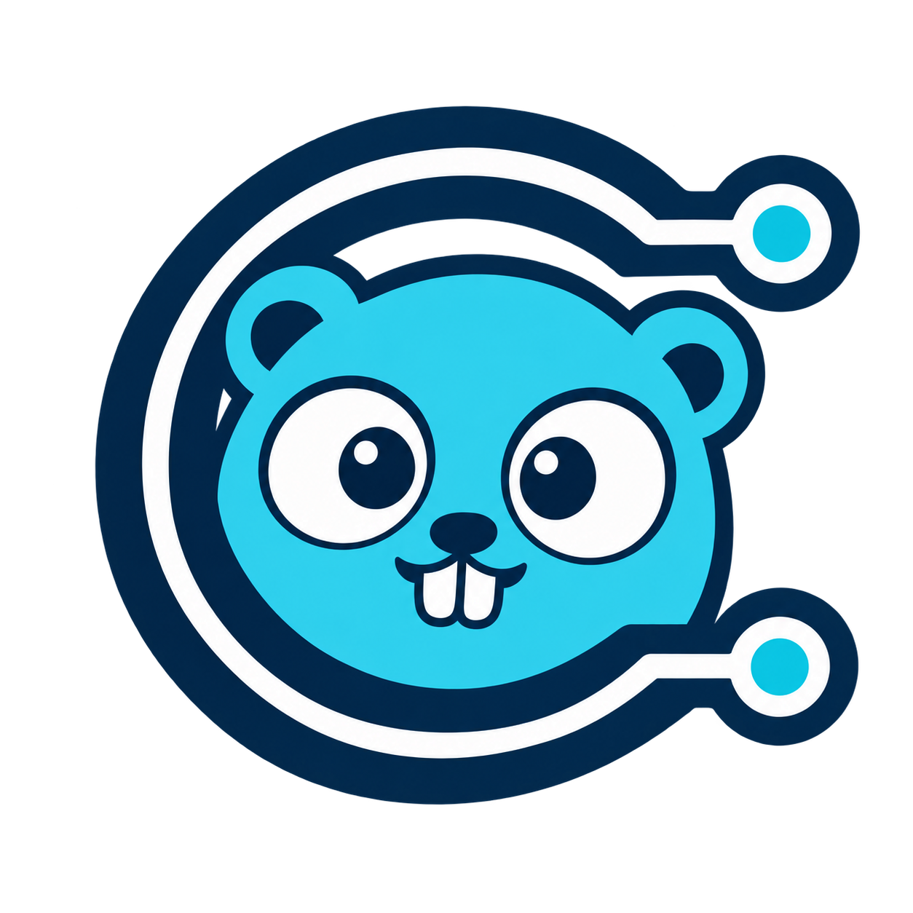

<p align="center">
  
</p>

# cago

A pure-Go EPICS Channel Access client and CLI. The library uses only the standard
library; no libca, EPICS Base installation, cgo, or external repeater is required
at runtime. Requires **Go 1.27 or newer**.

## Install

Download a prebuilt CLI for Linux, macOS, or Windows (amd64 or arm64) from
[GitHub Releases](https://github.com/wakonig/cago/releases). Extract the archive
and put `cago` (`cago.exe` on Windows) on your `PATH`. SHA-256 checksums are
provided in `checksums.txt`. Prebuilt binaries do not include Fyne plotting.

To install from source:

```sh
go get github.com/wakonig/cago/pkg/cago
go install github.com/wakonig/cago/cmd/cago@latest
```

## Library

Read, write, and subscribe through a channel handle:

```go
package main

import (
    "context"
    "fmt"
    "log"

    "github.com/wakonig/cago/pkg/cago"
)

func main() {
    ctx := context.Background()
    client, err := cago.New(ctx, cago.Options{})
    if err != nil {
        log.Fatal(err)
    }
    defer client.Close()

    channel := client.Channel("SLS:SETPOINT")

    // Get the current value.
    current, err := channel.Get(ctx)
    if err != nil {
        log.Fatal(err)
    }
    fmt.Println(current.Float64())

    // Put a new value.
    if err := channel.Put(ctx, 1.25); err != nil {
        log.Fatal(err)
    }

    // Subscribe to value updates.
    sub, err := channel.Subscribe(ctx, cago.WithMetadata(cago.Time))
    if err != nil {
        log.Fatal(err)
    }
    defer sub.Cancel()

    for event := range sub.Events() {
        fmt.Println(event.PV, event.Value.Float64(), event.Value.Metadata().Timestamp)
    }
}
```

Use `PutNotify` instead of `Put` to wait for IOC processing acknowledgement.
Subscriptions reconnect automatically. Call `sub.Cancel()` or cancel their context
to unsubscribe; recoverable monitor failures are reported through `sub.Errors()`.

Features include reads and writes, shared subscriptions, native CA types and
metadata, array support, grouped operations, and client metrics. Discovery uses
standard `EPICS_CA_*` environment variables and can be configured with `cago.Options`.
Supports IPv4 Channel Access clients; CA servers and pvAccess are outside its scope.

## CLI

```sh
cago get PV:NAME
cago put PV:SETPOINT 1.25
cago info PV:NAME
cago monitor PV:CURRENT PV:SETPOINT
cago monitor --table PV:CURRENT PV:SETPOINT
```

Monitoring opens a timestamp-first history table with PV names as column headers.
Each update adds a row. The header stays fixed; scroll up to pause following new
rows and press End to resume. The latest 10,000 events are retained. Use `--table`
for one row per PV showing its latest value, timestamp, alarms, and connection
state. Arrow keys and Page Up/Down scroll; `q` or Ctrl+C exits. Both modes require
interactive terminal input and output.

Use `cago <command> --help` for options. For local discovery, for example:

```sh
EPICS_CA_ADDR_LIST=127.0.0.1 EPICS_CA_AUTO_ADDR_LIST=NO cago get PV:NAME
```

## Development

### Releases

After CI succeeds on a push to `main`, semantic-release determines the next
version from Conventional Commit messages and publishes a GitHub Release with
release notes, six binary archives, and SHA-256 checksums. No manual tag or npm
publication is needed. The first release is `v1.0.0`.

- `fix: ...` creates a patch release.
- `feat: ...` creates a minor release.
- A `BREAKING CHANGE:` footer creates a major release.
- Documentation, test, and maintenance commits do not trigger a release.

When squash merging, use a Conventional Commit PR title and preserve any
`BREAKING CHANGE:` footer in the final commit message.

Node.js 24 is only needed for release tooling (`npm ci`). With GoReleaser v2.18.0
installed, preview the binary archives locally without publishing:

```sh
RELEASE_VERSION=0.0.0-dev goreleaser release --snapshot --clean
```

Repository rules must allow the Actions `GITHUB_TOKEN` to create `v*` tags and
releases. Release automation uses only the token provided by GitHub Actions.

### Checks

```sh
go test -race -shuffle=on -coverprofile=/tmp/cago-coverage.out ./...
./scripts/check-coverage.sh /tmp/cago-coverage.out 90
go vet ./...
CGO_ENABLED=0 go build ./...
```

IOC integration tests require EPICS Base's `softIoc` on `PATH`:

```sh
CAGO_REQUIRE_IOC=1 go test -race -tags=e2e -timeout=5m ./test/e2e
```

See the [technical reference](docs/reference.md) for API behavior, configuration,
CLI details, metrics, and compatibility limits.

## Icon attribution

The Cago icon is an adaptation of the Go gopher by Renée French, licensed under
[Creative Commons Attribution 4.0](https://creativecommons.org/licenses/by/4.0/).
